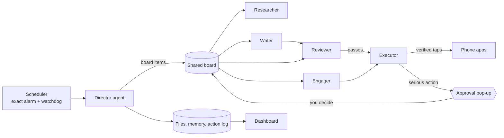

<div align="center">

# Zafiro Autonomous

### An AI team that runs your phone, day and night.

Scheduled, goal-driven agents that operate the real apps on your Android phone the way a person would, report what they did, and ask you only when it matters.

[](https://github.com/TricretA/my-zafiro/releases/latest)
[](https://github.com/TricretA/my-zafiro/actions/workflows/ci.yml)
[](LICENSE)
[](#requirements)
[](#build-from-source)

[**Download**](https://github.com/TricretA/my-zafiro/releases/latest) ·
[**Quick start**](#quick-start) ·
[**Features**](#features) ·
[**Report a bug**](https://github.com/TricretA/my-zafiro/issues/new?title=%5BBUG%5D+) ·
[**Request a feature**](https://github.com/TricretA/my-zafiro/issues/new?title=%5BFEATURE%5D+)

</div>

---

## Contents

- [Overview](#overview)
- [Features](#features)
- [How it works](#how-it-works)
- [Quick start](#quick-start)
- [Teams (workspaces)](#teams-workspaces)
- [The dashboard](#the-dashboard)
- [Tools, skills and MCP](#tools-skills-and-mcp)
- [Safety model](#safety-model)
- [Staying up to date](#staying-up-to-date)
- [Requirements](#requirements)
- [Build from source](#build-from-source)
- [Project layout](#project-layout)
- [FAQ](#faq)
- [Status and roadmap](#status-and-roadmap)
- [Contributing](#contributing)
- [License and credits](#license-and-credits)

## Overview

**Zafiro Autonomous** is a fork of the open-source [Zafiro](https://github.com/niki914/zafiro) (MIT), an Android AI agent that can read and operate the screen, run tools, and call MCP servers.

The original answers when you talk to it. This fork turns it into a **worker that keeps going on its own**: it wakes on a schedule, works through a shared task board with a team of specialised agents, uses the real apps on the phone, writes files you can open, and stops to ask you only for serious decisions.

It is built for people who want to run things from a phone without sitting in front of it: content and audience growth, inbox and outreach, job applications, monitoring, and recurring chores.

## Features

| Area | What you get |
|---|---|
| **Scheduling** | Daily, weekly, interval and one-time tasks with step, time and token limits, automatic retries, missed-run recording, and model fallback when a provider is down |
| **Teams** | 14 ready-made workspaces. Each team has a director, researcher, strategist, writer, reviewer, engager, executor and analyst, plus its own schedule, rulebook and playbook |
| **Shared board** | Every handoff between agents is a record with an owner, status and result. Work left half-done by a crash is re-opened. Delegation is limited to three levels |
| **Dashboard** | Live view of who is working right now, a live activity log you can watch, Stop and Run now, approvals, charts and history |
| **Approvals** | A pop-up on any screen for serious actions. Approve, reject, or add your own words; your opinion is stored as an example the reviewer learns from |
| **Screen routines** | One call runs a whole job on the phone. Every tap must change the screen, retries once, then reports a clear failure instead of looping. Routines are JSON files you can edit without rebuilding |
| **Files** | Plans, drafts and reports the agents save open inside the app: PDF, Markdown, HTML, images, audio, video, CSV, Office documents, archives and any other file |
| **Memory** | Self-learning memory with readable titles you can edit or delete, plus a reflection step after every run |
| **Tools** | Web search, page reader, RSS, exact dates, image cards, file read and write, scheduling, clipboard, HTTP, shell and Python |
| **Skills** | 270+ bundled skills (marketing, social, design, research, business) that load only when needed |
| **MCP** | 30+ servers pre-listed, with OAuth sign-in (browser login, automatic token renewal) |
| **Voice input** | The phone's free recogniser, or Groq / OpenAI / any compatible Whisper service with your key |
| **Backup** | Selective export plus a full backup of agents, tasks, teams, memory, MCP, skills, files and chats |
| **Updates** | In-app updates with the changelog; daily replay of upstream changes into this fork |

## How it works



1. **Wake.** One exact alarm per phone, backed by the database. Missed runs are recorded and caught up.
2. **Plan.** The director reads the board, the day's caps and your corrections, and creates work for the right specialists.
3. **Do.** Specialists take items, produce evidence (files, counts, screen readbacks) and mark them done or failed.
4. **Gate.** Each outward action asks the gate first. Normal work goes ahead within daily caps and human-paced waits; serious work waits for you.
5. **Learn.** After each run the agent saves lessons. Your approvals and rejections become examples for the reviewer.

## Quick start

1. Download the latest `.apk` from the [Releases page](https://github.com/TricretA/my-zafiro/releases/latest) on your phone.
2. Allow installing from your browser when Android asks.
3. Open the app and add a model provider (any OpenAI-compatible service, NVIDIA NIM, OpenRouter, Anthropic and others).
4. Grant the permissions it asks for: accessibility (to operate the screen), notifications, and battery exemption.
5. Open **Teams** in the menu and switch on a team.
6. Open the **Dashboard** to watch it work. Tap **Run now** to start the first cycle immediately.

> **Tip:** for unattended work keep the phone charged, remove the screen lock if you accept the trade-off, and exempt the app from battery optimisation. Some phone makers kill background apps aggressively; the Tasks page shows what to change on yours.

## Teams (workspaces)

Switching a team on installs its agents and schedule, enables its skills, and starts its heartbeat. Each team ships with:

- eight role agents with clear boundaries and a persistence rule (finish, take the next item, create the next work);
- about ten scheduled tasks (morning plan, research, production, four engagement rounds, daily stats, digest, overnight drafting, weekly review);
- a playbook (platform facts, formats, daily caps, research tools) and a rulebook that overrides older notes;
- screen routines for the platform's app.

| Team | Focus |
|---|---|
| Substack | Notes, posts, comments, restacks, audience growth |
| LinkedIn | Posts, comments, connection messages (drafts) |
| Instagram, TikTok, YouTube, Pinterest | Content planning and preparation; the final upload stays with you until a publish routine is proven |
| Facebook, Reddit, Threads | Posts and community engagement |
| X (Twitter) | Off by default |
| Email, WhatsApp | Inbox triage, drafts, daily digest |
| Job hunt | Applications and outreach tracker |
| Phone health | Watchdog: awake, unlocked, battery, Shizuku, network |
| Skill Builder | Turns a repo, document or page into an installed skill |

You can delete any team, including the defaults, and restore it later.

## The dashboard

- **Live cards** for every running task: agent, task, elapsed time, steps. **Watch** shows tool calls and what the agent says as it happens; **Stop** ends that run cleanly.
- **Needs you**: tap any run that is waiting for you, read the formatted summary, then **Approve** or **Reject** with an optional note. Selecting and copying the text works.
- **Team avatars** pulse while an agent is working. Tap one to message it, stop it, or give it a task.
- Board counters, a seven-day chart, success ring and a filterable activity timeline.

## Tools, skills and MCP

**Built-in tools:** screen operation and routines, open/launch, web search and fetch, RSS reader, date arithmetic, image card maker, file save/read, scheduling, board, engagement gate, examples library, skill creator, clipboard, HTTP, shell, Python, memory, notifications, and more.

**Skills** are short instruction files an agent loads on demand. A Skill Builder agent can create new ones from a GitHub repo, a document or a web page.

**MCP servers** are listed ready to switch on: documentation servers (on by default), design, payments, SEO, social analytics, image and video generation, search and scraping. Servers that need a login show a **Sign in** button that runs the browser OAuth flow and renews the token for you.

## Safety model

- **Approvals by default only for serious actions:** direct messages, sending email, payments, deletions, job applications. Ten approvals in a row make a type automatic; one rejection makes it ask again.
- **Daily caps and human pacing** per platform, so accounts behave like a person.
- **Never bypasses** locks, CAPTCHAs, 2FA, consent screens or payments: it hands over to you.
- **Success means evidence.** A run is only counted as done with a result that names what was produced or seen.
- **Your data stays on the phone.** There is no telemetry in this fork. API keys are stored locally in plain text, like the original; use the backup option accordingly.
- **Autonomous operation is a trade-off.** Review what you enable, keep caps modest, and read each platform's terms before automating an account.

## Staying up to date

- **Inside the app:** *Settings > About > Version* shows the latest release with its changelog and installs it in place.
- **The original project:** a daily `upstream-sync` workflow replays new upstream commits onto a branch, CI builds and tests them, and releases of this app ship the merged result. [`UPSTREAM_SYNCED_SHA`](UPSTREAM_SYNCED_SHA) records the last upstream commit merged. The original Zafiro is a separate app and cannot be installed over this one.

## Requirements

- Android 8.0 or newer (tested on Android 12).
- An accessibility service permission for screen control; Shizuku or root are optional extras that unlock more.
- A model provider and API key.
- For 24/7 use: a charger, battery-optimisation exemption, and the maker-specific autostart setting.

## Build from source

Builds run in GitHub Actions; see [`.github/workflows`](.github/workflows). To build locally you need JDK 17, the Android SDK (compileSdk 37), and Gradle 9.

```bash
git clone https://github.com/TricretA/my-zafiro.git
cd my-zafiro
./gradlew :app:assembleDebug          # debug APK
cd autonomy/core && gradle test       # pure-Kotlin scheduler and team rules
python3 tools/autonomous/gen_workspaces.py   # regenerate workspaces, skills and routines
```

Release builds are signed and minified by `release.yml` and published as GitHub releases.

## Project layout

```
app/                 Compose UI, settings, dashboard, backups, updater
agent-runtime/       LLM calls, tools, skills, MCP, screen routines
autonomy/core/       Pure-Kotlin scheduler, budgets, board rules (unit-tested anywhere)
autonomy/android/    Room database, alarms, run executor, team service, workspaces
business/            Contracts and agent orchestration
accessibility/       Screen reading and operation
voice/               Speech-to-text (device and cloud engines)
tools/autonomous/    Generators and CI helpers
```

## FAQ

**Is it safe to leave running?** It is designed to ask before serious actions and to stop on anything unusual, but it is early software. Start with one team, watch the dashboard for a few days, then widen.

**Does it work without root?** Yes. Accessibility is enough for screen control.

**Why does it say it needs me?** Either a serious action is waiting, or the phone was locked or a verification appeared. Tap the run on the dashboard to answer.

**Can I use my own model?** Yes: any OpenAI-compatible endpoint, with a fallback chain when one fails.

**Will it get my accounts banned?** Platforms differ and some forbid automation. This project drives the official apps at human pace with low caps, but it cannot guarantee how any platform treats an account. You are responsible for your accounts.

## Status and roadmap

Built quickly and tested through CI and real use on a single phone. Expect rough edges, especially in screen routines, which need calibrating per app. See [CHANGELOG](CHANGELOG.md) and [ROADMAP](ROADMAP.md).

Next: per-platform specialist agents built from open-source tooling, steering a run in progress with new instructions, more verified publish routines.

## Contributing

Bug reports and ideas are welcome through [issues](https://github.com/TricretA/my-zafiro/issues). Pull requests should include tests where logic is pure, and must not add telemetry, secrets or personal data. Do not commit screenshots or logs without checking them for private details first.

## License and credits

Released under the [MIT License](LICENSE). Zafiro was created by [niki914](https://github.com/niki914/zafiro); this fork keeps the original license and credits. Bundled skills keep their own licenses (see [NOTICE](NOTICE)).

Maintained by [TricretA](https://tricreta.co.ke).
